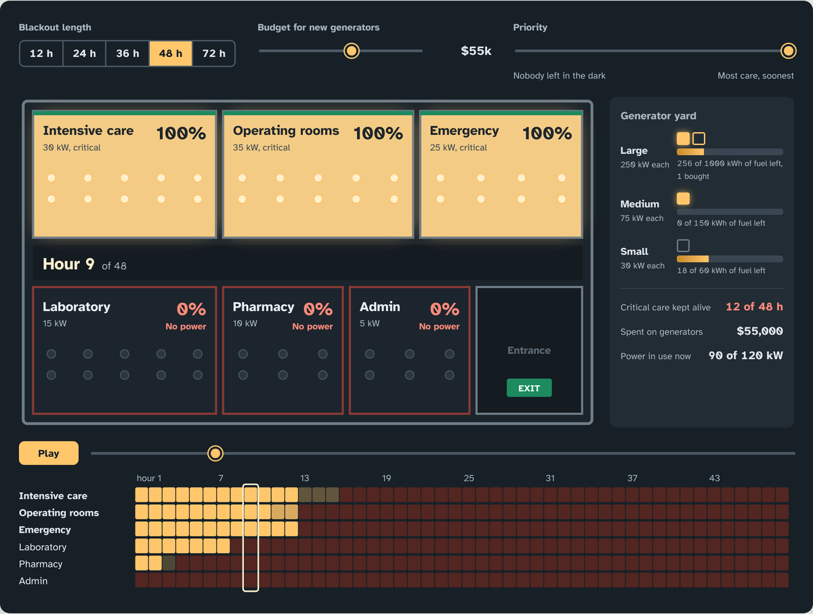

<div align="center">
  
</div>

# Hospital Energy Optimization

A hospital loses grid power. It has a fixed budget for generators, limited fuel, and six departments that all want electricity: intensive care, operating rooms, emergency, lab, pharmacy and admin. Who gets power, for how long, and which generators should the hospital have bought beforehand?

This project answers both questions with one mixed-integer linear program in Pyomo. Built as a course project at Comillas ICAI (September–December 2025).

**[Open the blackout simulator →](https://liiiaamm.github.io/hospital-energy-optimization/)**

[](https://liiiaamm.github.io/hospital-energy-optimization/)

Pick a blackout length, a budget and a priority, and watch the optimal plan play out hour by hour on the hospital's floor plan, with generators running and fuel tanks draining.

## The model

Two decisions are taken together:

- **Before the blackout (investment):** how many large, medium and small generators to buy, $z^{inv}_g$, subject to $\sum_g \text{Cost}_g \, z^{inv}_g \le \text{Budget}$.
- **During the blackout (operation):** which generators run each hour, how much energy each produces, and what fraction $x_{s,t}$ of each department's demand is covered.

The objective trades off two goals that pull in opposite directions:

$$
\max \; Z = \lambda \sum_{t}\sum_{s} \frac{W_s \, x_{s,t}}{(1+\alpha)^{t-1}} \; + \; (1-\lambda) \, K \, z^{min}
$$

- **Utility (first term):** serve the most important departments, weighted by $W_s$ (intensive care = 100, admin = 5). The discount $\alpha$ makes early hours count more.
- **Equity (second term):** maximise $z^{min}$, the worst weighted coverage, so no department is left in the dark for long.

Constraints cover the budget, generator availability and power limits, fuel tanks, the hourly energy balance, a minimum level for critical care, monotonic load shedding, a maximum coverage gap between critical departments, and a cap on generator start-ups.

## What 200 scenarios show

The simulator plays back the optimal plan for every combination of 5 blackout lengths (12–72 h), 8 budgets ($0–$165k) and 5 priority weights $\lambda$.

- **The priority weight matters more than the money.** With $\lambda \le 0.25$, critical care keeps at least 10 % of its demand for the whole blackout in 38 of the 40 length and budget combinations. With $\lambda = 1$ (pure utility) that happens in only 3 of them: the plan runs everything at full power and goes dark once the fuel is gone.
- **Fuel per dollar decides what to buy.** A large unit stores 9.1 kWh of fuel per $1,000, a medium one 5.6 and a small one 4.0, so the optimiser buys large generators whenever the budget reaches one. The original report highlighted medium units; with these parameters the solver disagrees.
- **Balanced plans are hybrids.** With a large budget and $\lambda = 0.5$, the hospital runs at full power for the first hours and then switches to a steady ration until the grid returns.

The full formulation, sensitivity analysis and 100-hour simulations are in [`docs/Project_Final_Report.pdf`](docs/Project_Final_Report.pdf).

## Run it

Everything runs on free software. The solver is [HiGHS](https://highs.dev); Gurobi is used instead if it is installed and licensed.

```bash
git clone https://github.com/liiiaamm/hospital-energy-optimization.git
cd hospital-energy-optimization
python -m venv .venv && source .venv/bin/activate
pip install -r requirements.txt

python src/model.py 48 55000 0.5      # one scenario: hours, budget, lambda
python scripts/precompute.py          # all 200 scenarios -> docs/scenarios.json (about 2 minutes)
jupyter notebook src/optimization_model.ipynb
python -m http.server                 # then open http://localhost:8000 for the simulator
```

## Repository layout

| Path | What's there |
|---|---|
| `src/model.py` | The MILP as a reusable function, with HiGHS or Gurobi |
| `src/optimization_model.ipynb` | Original notebook with the step-by-step formulation and plots |
| `scripts/precompute.py` | Solves the scenario grid for the simulator |
| `index.html`, `static/` | The blackout simulator |
| `docs/scenarios.json` | Precomputed optimal plans |
| `docs/Project_Final_Report.pdf` | Full report |

A note on one metric: the model's binary $y_t$ ("critical care above its minimum level") does not appear in the objective, so the solver is free to leave it at 0, and counting it under-reports how long the hospital holds on. The simulator measures survival directly from the coverage $x_{s,t}$ instead.

## Team

- Liam Esgueva González
- Andrés Gil Vicente
- Jorge Carnicero Príncipe
- Jorge González Pérez
